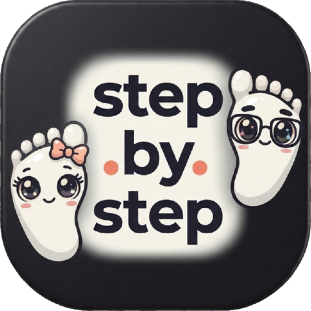
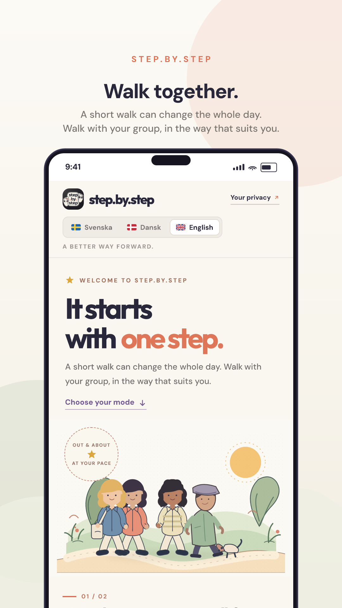
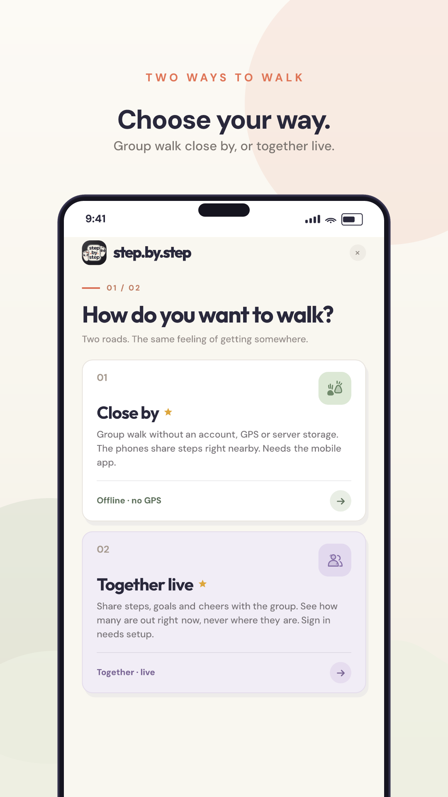
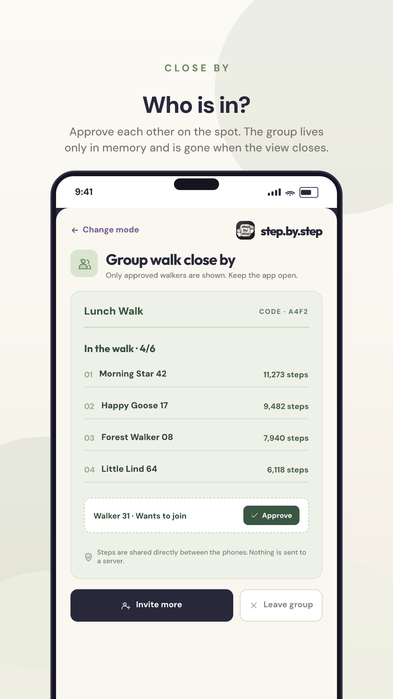
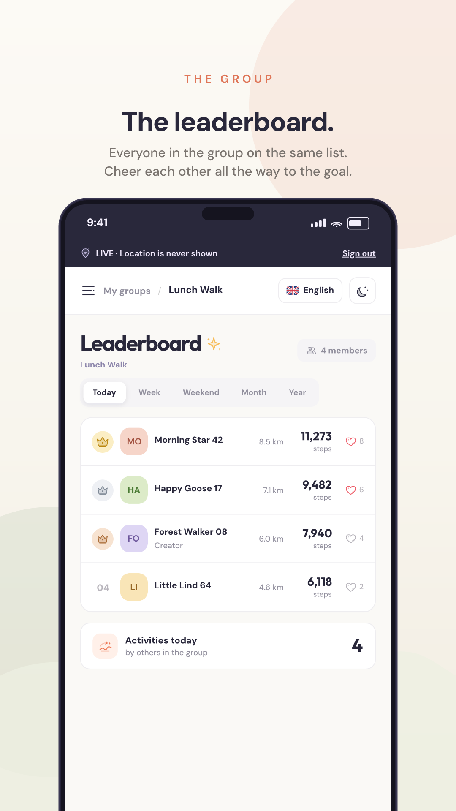
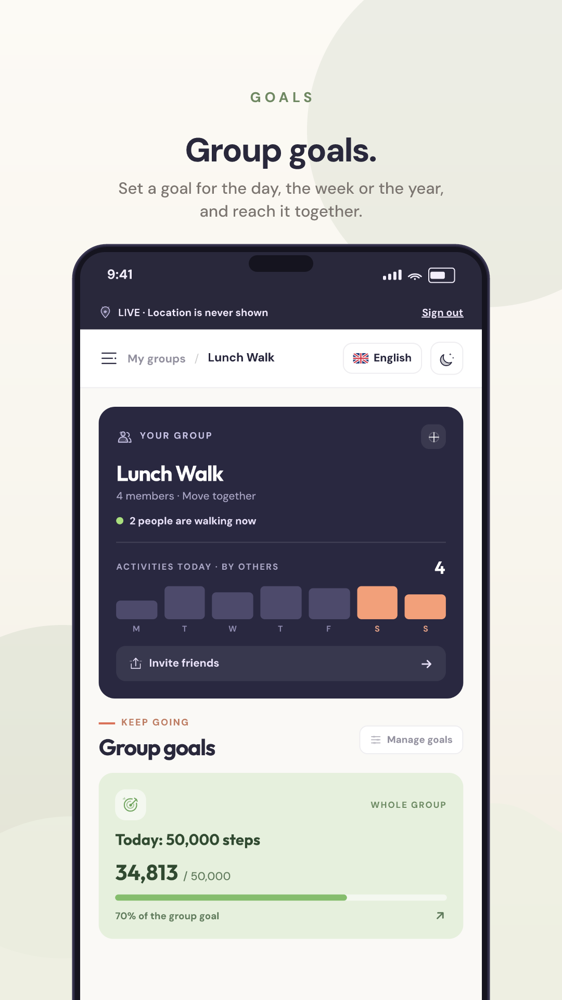

<div align="center">



### One step at a time, together.

A short walk can change the whole day.<br />
Steps, distance, goals and a leaderboard for the whole group, without anyone giving away their location.


</div>

<br />

<table align="center">
<tr>
<td align="center" width="160"><br /><sub><b>Landing</b><br />Pick a language first</sub></td>
<td align="center" width="160"><br /><sub><b>Two ways to walk</b><br />Close by or together</sub></td>
<td align="center" width="160"><br /><sub><b>Close by</b><br />Group walk, no server</sub></td>
<td align="center" width="160"><br /><sub><b>Leaderboard</b><br />Steps and cheers</sub></td>
<td align="center" width="160"><br /><sub><b>Goals</b><br />Day, week, year</sub></td>
</tr>
</table>


<br />

**step.by.step** is a walking app for groups. The group gathers, walks together or apart, and sees how everyone is doing. No email addresses, no maps of people, no points that require the phone to stay open all day.

<div align="center">

</div>

## Two ways to walk

| Mode | What it is | What is shared |
| :--- | :--- | :--- |
| **Close by** <br /> Group walk without an account | A group nearby walks together. Steps are read from the phone health store in the installed app. No GPS, no server, no accounts. | Display name and step total travel directly between the phones. The group list lives only in memory and disappears when the view closes. |
| **Together live** <br /> The group is spread out | Shows how many people are active, plus steps and distance for the group. | Number of active people, steps and estimated distance. Never a name on a map, never anyone route. |

Both modes use the same logo, the same typefaces, the same colours and the same language choice. A nickname is enough, no email address needed.

## What is in the app

| Feature | How it works |
| :--- | :--- |
| **Language from the first second** | Swedish, Danish and English with flag and language name on the landing screen. The whole interface switches language, including errors and the footer. |
| **One logo everywhere** | The same wordmark in the header, in sign in, in the offline mode, in the test mode, as the browser icon, as the Android icon and as the iOS icon. |
| **Several groups at once** | Create as many groups as you like, invite with a link or a six character code, and leave a group after confirming. When the last member leaves, the group is removed. |
| **A name per group** | The app asks what you want to be called in that particular group, so the same person can have different names in different teams. |
| **Goals for every period** | Day, week, weekend, month and year. A group can also set one shared goal that all steps count towards. |
| **A leaderboard per group** | Every group has its own leaderboard with steps, kilometres and cheer hearts. Medals and a crown are handed out across the whole podium. |
| **Celebration when a goal is reached** | When a goal is met, an animated scene plays that clearly shows which goal the group reached. A separate scene for day, week, weekend, month, year and for the shared goal. |
| **Pair two groups** | Share a code or a link. The other group only sees the shared goal and the member count, never personal goals, names or steps per person. |
| **Analysis map** | When two groups are paired, an animated map ranks the groups for the day, week or month, with a crown on the leader and a line saying how many steps ahead or behind you are. |
| **Nickname account** | An account with only a nickname, no email. The password is stored as a scrypt hash with a salt. |
| **Test mode** | **Try the app without an account** opens the screens with sample data in a clearly marked test mode. No fake sign in, no requests, nothing stored. |
| **Light and dark** | Two complete themes in the same palette, plus mobile layout down to 320 px. |

## Privacy

| Question | Answer |
| :--- | :--- |
| Is my location shared? | No. The position is used only on the phone to work out the distance. The server receives metres and measurement quality, and rejects any request that contains coordinates. |
| Is the offline group stored? | No. Names, steps and the leaderboard live only in memory while the view is open. |
| What is stored about me? | A display name you choose yourself and your steps. No email, no phone number, no address. |
| Can I disappear? | Yes. Leave the group, or delete the account, and your data is removed. |

## How steps are measured

1. In the installed app, steps come from the phone health store, HealthKit on iOS and Health Connect on Android, after you grant read access.
2. Distance is calculated as steps times 0.75 metres and shown as an estimate.
3. In the live mode the phone works out the distance itself while the page is open. Bad fixes, jumps and impossible speeds are filtered out before anything is sent.
4. The group card shows how many walking activities other members have had per day. Movement within 15 minutes counts as the same activity, and an activity needs at least 100 metres of accepted distance.
5. Dates and periods follow the Europe/Stockholm time zone, so the week starts on Monday and the weekend is Saturday and Sunday.

A web browser cannot read the steps from the phone and cannot track reliably in the background. The web version therefore shows a clear message instead of made up numbers. Real steps and robust measurement require the installed app.

## Technology

| Part | Choice |
| :--- | :--- |
| Interface | React 19, TypeScript 5.8, Vite 6, Motion for animation |
| Type and colour | Outfit for headings, DM Sans for body text, both bundled locally |
| Icons and illustration | Custom SVG components, no icon font and no external requests |
| Server | Express with TypeScript, data in `data/steps.json` |
| Mobile | Capacitor 8 for Android and iOS, Health Connect and HealthKit for steps |
| Sharing nearby | Bluetooth Low Energy directly between phones, custom service `e672a300-c4be-429e-89ec-df1477a51101` |
| Sign in | Supabase Auth with Google and Apple, plus a nickname account with scrypt |
| Tests | Vitest with Testing Library, 42 tests in 7 files |

## Get started

```bash
npm install
npm run dev
```

Open **http://localhost:3000**. Vite serves the interface on port 3000 and the API listens on port 3001.

```bash
npm run build        # production build
PORT=3000 npm start  # serve the build with the API
npm test             # 42 tests
npm run lint         # type check with tsc
```

For mobile:

```bash
npm run build && npx cap sync
npx cap open android
npx cap open ios
```

Android requires API 26 or higher. Health Connect and HealthKit need their own permission descriptions and should be tested on physical phones before release.

Static hosting, such as GitHub Pages, cannot run the group features, because they need the API and a persistent disk. The server needs HTTPS and a domain you control.

## API

| Method | Path | Does |
| :--- | :--- | :--- |
| `POST` | `/api/accounts` | Creates a nickname account |
| `POST` | `/api/accounts/login` | Signs in with nickname and code |
| `POST` | `/api/groups` | Creates a group |
| `POST` | `/api/groups/:id/join` | Joins with a code |
| `POST` | `/api/groups/:id/leave` | Leaves the group |
| `POST` | `/api/track` | Sends metres and measurement quality, never coordinates |
| `POST` | `/api/groups/:id/goals` | Adds a goal |
| `PATCH` | `/api/groups/:id/goals/:goalId` | Changes a goal |
| `POST` | `/api/groups/:id/like` | Cheers a member |
| `POST` | `/api/groups/:id/pair-code` | Returns the pairing code for the group |
| `GET` | `/api/pair/:code` | Shows what a code leads to |
| `POST` | `/api/groups/:id/partners` | Pairs two groups |
| `GET` | `/api/state` | Returns the current state of the group |

## Project structure

```text
step.by.step
├── src
│   ├── App.tsx              group view, leaderboard, goals and pairing
│   ├── ModeGate.tsx         the choice between the two modes
│   ├── OfflineGroup.tsx     the group walk close by
│   ├── PrivateMode.tsx      offline statistics and health data
│   ├── Celebration.tsx      animated scenes when a goal is reached
│   ├── components           logo, icons, language picker, illustration
│   └── *.test.tsx           tests with Vitest
├── server.ts                API, accounts, groups and goals
├── public                   logo, icons and privacy text
├── art                      illustrations for web and store
├── store                    screenshots and material for Google Play
├── scripts                  icon export, scene rendering and store images
├── android                  Capacitor project for Android
└── ios                      Capacitor project for iOS
```

## Good to know

1. Group data is stored in `data/steps.json`. It is not a production database and has no backup, retention or self service export. Set up a real database before public use.
2. A client can send the wrong metre figures. Without further server side checks the numbers are an estimate, not a verified result.
3. Bluetooth between iPhone and Android, background tracking and health permissions must be tested on real phones before launch.
4. `public/privacypolicy.html` is a draft, not a finished legal privacy text.
5. The bundle identifier in the mobile projects is temporary and should be changed to one you control.

## License

step.by.step is free to download, use, change and share for education and other non commercial use. You may not sell the project or earn money from it, directly or indirectly.

To use step.by.step commercially, for example in a paid app, in a business or in a service you charge for, you need a paid license agreed with nrnworld.one through [nrnworld.one](https://nrnworld.one) or [bynrnworld@gmail.com](mailto:bynrnworld@gmail.com).

Credit to nrnworld.one is always required, and modified versions must be marked and keep the same terms. The full license text is in [LICENSE](LICENSE) and is written in English. The license is source available but not an OSI approved open source license, because commercial use requires an agreement.

```text
step.by.step by nrnworld.one, used for education under the step.by.step Educational License.
https://nrnworld.one
```

<div align="center">
<br />
<sub>Created by <a href="https://nrnworld.one">nrnworld.one</a> · <a href="mailto:bynrnworld@gmail.com">bynrnworld@gmail.com</a></sub>
</div>
